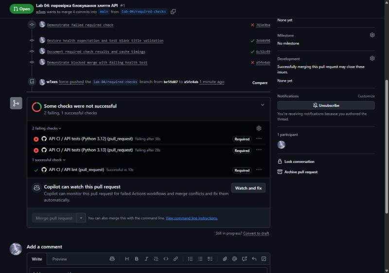
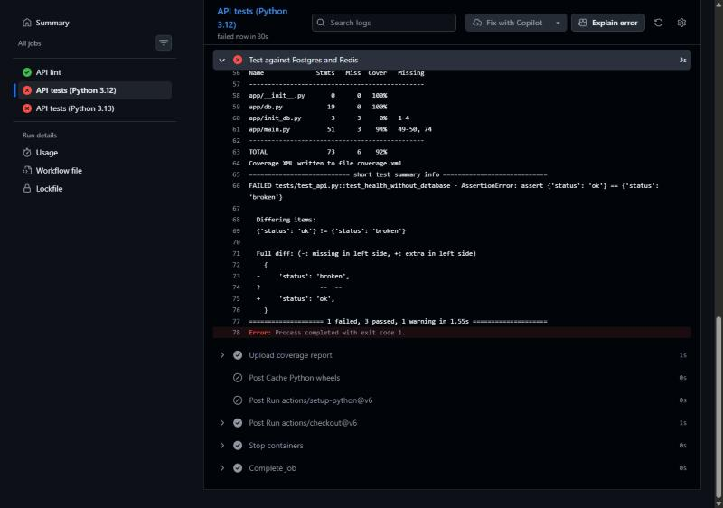
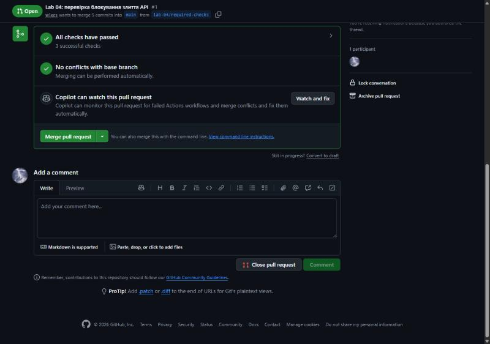

# Перевірки Wishlist API

## Обов’язкові перевірки

Для `main` діє ruleset із обов’язковим pull request, актуальністю щодо `main`, скиданням застарілих схвалень і забороною видалення та force-push. Список обходу порожній. В індивідуальній роботі кількість обов’язкових схвалень дорівнює нулю. Для злиття мають пройти `API lint`, `API tests (Python 3.12)` і `API tests (Python 3.13)`. [Налаштування ruleset](https://github.com/w1xes/wishlist-api/rules/27492370)

Доказ блокування — [PR №1](https://github.com/w1xes/wishlist-api/pull/1). У ньому коміт `a5fe4ab` навмисно змінив очікування в тесті `test_health_without_database`, а коміт `ed529f0` повернув правильне.

**1. Червоні перевірки й заблокована кнопка злиття.** На коміті `a5fe4ab` лінтер пройшов, а `API tests (Python 3.12)` і `API tests (Python 3.13)` впали. Кнопка **Merge pull request** неактивна. [Прогін](https://github.com/w1xes/wishlist-api/actions/runs/45461042526)

**2. Рядок помилки в журналі.** Журнал кроку `Test against Postgres and Redis` показує `FAILED tests/test_api.py::test_health_without_database - AssertionError: assert {'status': 'ok'} == {'status': 'broken'}`. [Журнал pytest](https://github.com/w1xes/wishlist-api/actions/runs/45461042526/job/138683503281)

**3. Той самий pull request після виправлення.** Коміт `ed529f0` повернув очікування `ok`. Усі три обов’язкові перевірки зелені, кнопка **Merge pull request** активна. [Успішний прогін](https://github.com/w1xes/wishlist-api/actions/runs/45461426704)

## Вимірювання кешу

Дві спроби того самого прогону на `main`, коміт `7aa43a2`. Час узято з міток початку й завершення спроб у GitHub Actions.

| Прогін | Час |
|---|---:|
| [Без кешу](https://github.com/w1xes/wishlist-api/actions/runs/44166854130/attempts/1) | 59 с |
| [З кешем](https://github.com/w1xes/wishlist-api/actions/runs/44166854130/attempts/2) | 61 с |

Найдовший крок — `Initialize containers`, 14 с у першій спробі.

У другій спробі обидва завдання матриці відновили кеш, пропустили завантаження wheels і встановили залежності локально з `.wheelhouse`. Повний прогін тривав на 2 с довше.

## Нічний аудит

Окремий workflow `API dependency audit` запускає `pip-audit`. Ручний контрольний запуск завершився без знахідок. [Результат аудиту](https://github.com/w1xes/wishlist-api/actions/runs/44167176255)
