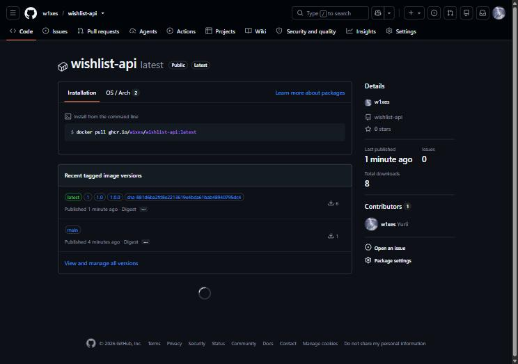

# Контейнеризація Wishlist (лабораторна 5)

Обидва застосунки зібрано в образи, весь стек (Postgres, Redis, API, UI) піднімається однією командою, CI збирає образи й публікує їх у GHCR. Цей документ описує образ API, стек у `compose.yaml`, діагностику та CI. Образ UI розібрано в [docs/containers.md репозиторію wishlist-ui](https://github.com/w1xes/wishlist-ui/blob/main/docs/containers.md).

Усі виміри зроблено на Windows 11 з Docker Desktop 29.9.3 і Compose v5.7.0. Виводи команд наведено дослівно, лише без зайвих рядків.

## Карта файлів

| Файл | Що робить |
|---|---|
| `wishlist-api/Dockerfile` | образ API: `python:3.12-slim`, залежності окремим шаром, користувач `app`, `CMD` у exec-формі |
| `wishlist-api/.dockerignore` | не пускає в контекст збирання `.git`, `.env*`, тести, документацію, кеші Python |
| `wishlist-api/app/main.py` | `lifespan` створює таблиці при старті, `UI_ORIGIN` читається як список origin через кому |
| `wishlist-api/compose.yaml` | стек `wishlist`: Postgres, Redis, API, UI, плюс профіль `dev` |
| `wishlist-api/.env.example` | шаблон змінних; справжній `.env` у `.gitignore` |
| `wishlist-api/.github/workflows/ci.yml` | lint, тести, збирання й публікація образу, скан Trivy |
| `wishlist-api/docs/containers.md` | цей документ |
| `wishlist-ui/Dockerfile` | образ UI: етап `build` (Node) і фінальний nginx |
| `wishlist-ui/.dockerignore` | не пускає `.env*`, `node_modules`, `dist`, `.git` |
| `wishlist-ui/nginx/default.conf` | конфігурація nginx: перехід на `index.html`, кеш, gzip |
| `wishlist-ui/.github/workflows/ci.yml` | lint, типи, збирання, публікація образу, скан Trivy |
| `wishlist-ui/docs/containers.md` | розмір образів, докази для UI |

`compose.yaml` лежить у `wishlist-api`. Образ UI він збирає з публічного репозиторію: `build.context` за замовчуванням дорівнює `https://github.com/w1xes/wishlist-ui.git#main`, тому для запуску достатньо клонувати лише `wishlist-api`. Щоб зібрати UI з локального клону (наприклад, перевірити ще не злиті зміни), задайте `UI_CONTEXT=../wishlist-ui` у `.env`.

## Образ API

### Dockerfile

```dockerfile
FROM python:3.12-slim

ENV PYTHONDONTWRITEBYTECODE=1 \
    PYTHONUNBUFFERED=1 \
    PIP_NO_CACHE_DIR=1 \
    PIP_DISABLE_PIP_VERSION_CHECK=1 \
    PIP_ROOT_USER_ACTION=ignore

WORKDIR /app

COPY requirements.txt ./
RUN pip install -r requirements.txt

RUN groupadd --gid 10001 app \
    && useradd --uid 10001 --gid app --no-create-home --shell /usr/sbin/nologin app

COPY app ./app

USER app

EXPOSE 8000

CMD ["uvicorn", "app.main:app", "--host", "0.0.0.0", "--port", "8000"]
```

| Рядок | Навіщо |
|---|---|
| `FROM python:3.12-slim` | конкретна гілка Python (на момент вимірів 3.12.16) і мінімальна основа Debian без компілятора. Тег не `latest` і не порожній. Це тег гілки, а не digest, тому патч-версії Python підтягуються при новому збиранні |
| `PYTHONDONTWRITEBYTECODE=1` | Python не пише `.pyc`. Код у `/app` належить root, користувач `app` туди писати не може, та й не потрібно |
| `PYTHONUNBUFFERED=1` | логи йдуть у `docker logs` одразу, без буфера |
| `PIP_NO_CACHE_DIR=1` | pip не залишає кеш у шарі образу |
| `PIP_DISABLE_PIP_VERSION_CHECK=1`, `PIP_ROOT_USER_ACTION=ignore` | прибирають зайві попередження pip під час збирання (збирання йде від root) |
| `COPY requirements.txt` і `RUN pip install` | залежності в окремому шарі й **до** копіювання коду. `requirements.txt` згенеровано `pip-compile`, усі версії зафіксовано. Шар перебудовується, лише коли змінився цей файл |
| `groupadd`, `useradd` з uid/gid 10001 | звичайний (не системний) користувач без домашньої теки й оболонки. `--system` дав попередження про `SYS_UID_MAX`, бо uid більший за 999 |
| `COPY app ./app` | код копіюється останнім, бо змінюється найчастіше |
| `USER app` | процес працює не від root |
| `EXPOSE 8000` | документація порту, на публікацію не впливає |
| `CMD [...]` у exec-формі | uvicorn стає PID 1 і сам отримує SIGTERM, оболонки між Docker і застосунком немає. Слухає `0.0.0.0`, інакше порт не був би доступний ззовні контейнера |

У образі немає жодної конфігурації: хост і пароль бази, адреса Redis, дозволені origin передаються змінними середовища (`POSTGRES_HOST`, `POSTGRES_PORT`, `POSTGRES_USER`, `POSTGRES_PASSWORD`, `POSTGRES_DB`, `REDIS_URL`, `UI_ORIGIN`). Один образ підходить для будь-якого середовища.

Таблиці створює сам застосунок: `lifespan` у `app/main.py` викликає `Base.metadata.create_all(get_engine())` при старті. Запуск лишається простою командою uvicorn, обгортки зі скриптом немає.

### .dockerignore

| Запис | Чому |
|---|---|
| `.git`, `.gitignore`, `.gitattributes`, `.github` | історія й службові файли репозиторію |
| `.env`, `.env.*` | секрети та локальна конфігурація не потрапляють у контекст, а отже і в образ |
| `tests`, `docs`, `*.md`, `pyproject.toml`, `requirements-dev.*`, `requirements.in` | потрібні лише розробнику |
| `Dockerfile`, `.dockerignore`, `compose*.yaml`, `compose*.yml` | у рантаймі непотрібні |
| `.venv`, `venv`, `__pycache__`, `*.py[cod]`, `.pytest_cache`, `.ruff_cache`, `.coverage`, `coverage.xml`, `.wheelhouse` | локальні артефакти |

Результат: у контекст збирання потрапляють лише `app/*.py` і `requirements.txt`.

### Перевірки

Користувач, не root:

```
$ docker run --rm lab5-api:test whoami
app
$ docker run --rm lab5-api:test id
uid=10001(app) gid=10001(app) groups=10001(app)
```

У образі немає `.env`, `.git`, `tests` (команда виконується в `WORKDIR /app`):

```
$ docker run --rm lab5-api:test ls -a
.
..
app
requirements.txt
$ docker run --rm lab5-api:test ls -la /app/app
-rwxr-xr-x 1 root root    0 Nov 17 20:04 __init__.py
-rwxr-xr-x 1 root root 1022 Nov 17 20:10 db.py
-rwxr-xr-x 1 root root  107 Nov 17 20:04 init_db.py
-rwxr-xr-x 1 root root 2919 Nov 24 19:50 main.py
```

У `docker image inspect` для цього образу `Config.User` дорівнює `app`, `Entrypoint` дорівнює `null`, `Cmd` дорівнює `["uvicorn","app.main:app","--host","0.0.0.0","--port","8000"]`.

Змінив один рядок у `app/main.py` (у `/health` замінив `"ok"` на `"okay"`) і перезібрав. Крок встановлення залежностей узято з кешу, перебудовано лише `COPY app`:

```
$ docker build --progress=plain -t lab5-api:test .
#7 [3/6] COPY requirements.txt ./
#7 CACHED

#8 [4/6] RUN pip install -r requirements.txt
#8 CACHED

#9 [5/6] RUN groupadd --gid 10001 app     && useradd --uid 10001 --gid app --no-create-home --shell /usr/sbin/nologin app
#9 CACHED

#10 [6/6] COPY app ./app
#10 DONE 0.0s
```

Правку після перевірки скасовано, файл збігається з оригіналом побайтово.

Зупинка контейнера й PID 1:

```
$ docker exec lab5-a1-api sh -c 'cat /proc/1/cmdline | tr "\0" " "'
/usr/local/bin/python3.12 /usr/local/bin/uvicorn app.main:app --host 0.0.0.0 --port 8000
$ docker stop lab5-a1-api
lab5-a1-api
docker stop took 1.09 s
$ docker inspect --format 'ExitCode={{.State.ExitCode}} OOM={{.State.OOMKilled}}' lab5-a1-api
ExitCode=0 OOM=false
$ docker logs --tail 5 lab5-a1-api
INFO:     Shutting down
INFO:     Waiting for application shutdown.
INFO:     Application shutdown complete.
INFO:     Finished server process [1]
```

`docker stop` зайняв 1,09 с, код виходу 0. Процес із номером 1 це сам uvicorn, у логах `Started server process [1]` і `Finished server process [1]`.

Секрети й кеш pip. В `ENV` образу немає паролів, `ARG` не використано. У `docker history` власних шарів (команда `docker history --no-trunc --format '{{.CreatedBy}}' wishlist-api:local | head -9`) лише `ENV PYTHON*/PIP_*`, `WORKDIR`, `COPY`, `RUN pip install`, `RUN groupadd`, `USER`, `EXPOSE`, `CMD`. Пошук `pass|secret|token|key` у `env` контейнера знаходить лише `GPG_KEY` базового образу Python (ідентифікатор публічного ключа підпису релізів). Від root: каталогу `/root/.cache` немає, `pip cache dir` відповідає `ERROR: pip cache commands can not function since cache is disabled.`

Розмір:

| Образ | Розмір, байт |
|---|---:|
| `python:3.12-slim` (основа) | 177 325 924 |
| образ API | 264 840 093 (≈ 265 МБ) |

Залежності з `requirements.txt` і код додають до основи близько 88 МБ.

Без конфігурації контейнер швидко падає, а не висить напівживим. Без `POSTGRES_PASSWORD`: `KeyError: 'POSTGRES_PASSWORD'` і `Application startup failed. Exiting.`, код виходу 3. Якщо хост Postgres не резолвиться, при старті `OperationalError` і вихід. Тому в `compose.yaml` потрібні `depends_on` з `service_healthy` і політика перезапуску.

## Стек

### Запуск з нуля

```bash
git clone https://github.com/w1xes/wishlist-api.git
git clone https://github.com/w1xes/wishlist-ui.git
cd wishlist-api
cp .env.example .env            # PowerShell: Copy-Item .env.example .env
# у .env замінити POSTGRES_PASSWORD на власний пароль
docker compose up -d --build --wait
```

UI відкривається на <http://localhost:8081>, документація API на <http://localhost:8000/docs>. Решту змінних `.env` описано в `README.md`.

З порожнього стану (`down -v`) команда `docker compose up -d --build --wait` відпрацювала близько 16 с з теплим кешем збирання і завершилась кодом 0. Порядок старту з виводу Compose: спочатку Postgres і Redis, після `Healthy` стартує API, після `Healthy` API стартує UI.

```
$ docker compose ps
NAME                  IMAGE                COMMAND                  SERVICE    CREATED          STATUS                    PORTS
wishlist-api-1        wishlist-api:local   "uvicorn app.main:ap…"   api        14 seconds ago   Up 9 seconds (healthy)    127.0.0.1:8000->8000/tcp
wishlist-postgres-1   postgres:17-alpine   "docker-entrypoint.s…"   postgres   14 seconds ago   Up 13 seconds (healthy)   5432/tcp
wishlist-redis-1      redis:7.4-alpine     "docker-entrypoint.s…"   redis      14 seconds ago   Up 13 seconds (healthy)   6379/tcp
wishlist-ui-1         wishlist-ui:local    "/docker-entrypoint.…"   ui         14 seconds ago   Up 3 seconds (healthy)    127.0.0.1:8081->80/tcp
```

### Сервіси

Ім'я проєкту `wishlist` задано в самому файлі (`name: wishlist`).

| Сервіс | Образ | Healthcheck | Чекає на | Порт на хості | Перезапуск |
|---|---|---|---|---|---|
| `postgres` | `postgres:17-alpine` | `pg_isready -h 127.0.0.1 -U "$$POSTGRES_USER" -d "$$POSTGRES_DB"` | нічого | немає | `unless-stopped` |
| `redis` | `redis:7.4-alpine` | `redis-cli ping` | нічого | немає | `unless-stopped` |
| `api` | збирається з `.` (`wishlist-api:local`) | python-однорядник, запит `GET http://127.0.0.1:8000/ready` | `postgres` і `redis` зі станом `service_healthy` | `127.0.0.1:${API_PORT:-8000}` на 8000 | `unless-stopped` |
| `ui` | збирається з git-контексту `wishlist-ui`, гілка `main` (`wishlist-ui:local`) | `wget -q -O /dev/null http://127.0.0.1/` | `api` зі станом `service_healthy` | `127.0.0.1:${UI_PORT:-8081}` на 80 | `unless-stopped` |

Інтервал перевірок 3 с, таймаут 3 с, 15 спроб. У `api` `start_period` 5 с, у `ui` 3 с.

Деталі, які важливі:

- **Версії зафіксовано.** `postgres:17-alpine`, `redis:7.4-alpine`, `python:3.12-slim`, `node:24-alpine`, `nginx:1.30-alpine`. Тегів `latest` немає.
- **Healthcheck API** користується Python з образу, бо в `python:3.12-slim` немає `curl`. Він викликає `/ready`, а той перевіряє і Postgres, і Redis. Тож `healthy` означає, що API дійсно бачить обидві залежності. Наслідок: якщо база зникне вже під час роботи, API стане `unhealthy`.
- **Healthcheck Postgres** іде на `127.0.0.1` по TCP. Під час першої ініціалізації тому entrypoint піднімає тимчасовий сервер без TCP-слухача, тож перевірка через TCP стає успішною лише для справжнього сервера.
- **Healthcheck UI** користується `wget` з busybox, який є в `nginx:alpine`.
- **Порт API** слухає `0.0.0.0` усередині контейнера, а на хості опублікований лише на `127.0.0.1`. Зовні машини він недоступний.
- **CORS.** Браузер завантажує UI з `http://localhost:8081` і викликає API на `http://localhost:8000`. Тому `UI_ORIGIN` це список через кому: `http://localhost:8081,http://127.0.0.1:8081`. Перевірка:

```
$ curl -s -i -H 'Origin: http://localhost:8081' http://localhost:8000/items | head -12
HTTP/1.1 200 OK
...
access-control-allow-origin: http://localhost:8081
$ curl -s -i -H 'Origin: http://evil.example' http://localhost:8000/items | grep -i -E '^(HTTP|access-control)'
HTTP/1.1 200 OK
```

Для чужого origin заголовка `access-control-allow-origin` немає. Preflight `OPTIONS /items` з `Origin: http://localhost:8081` повертає 200 і `access-control-allow-origin: http://localhost:8081`.

### Дані: іменований том

Дані Postgres лежать у томі `pgdata`, змонтованому в `/var/lib/postgresql/data`. Compose назвав його `wishlist_pgdata`:

```
$ docker volume ls --filter name=wishlist_
DRIVER    VOLUME NAME
local     wishlist_pgdata
```

### Секрети

Пароль Postgres береться лише зі змінної `POSTGRES_PASSWORD` у `.env`. У `compose.yaml` усі три місця, де вона використовується (`postgres`, `api`, `api-dev`), записані у формі `${POSTGRES_PASSWORD:?...}` без значення за замовчуванням:

```
$ grep -n 'POSTGRES_PASSWORD' compose.yaml | grep -v ':?'
(порожньо: рядків без форми :? немає)
```

Без секрету Compose відмовляється стартувати. Перевірено двома способами: файл змінних без `POSTGRES_PASSWORD` і файл із порожнім значенням. Результат однаковий (код виходу 1, контейнери не створено, `docker compose ps -a` порожній):

```
$ docker compose --env-file noparam.env up -d
error while interpolating services.api.environment.POSTGRES_PASSWORD: required variable POSTGRES_PASSWORD is missing a value: POSTGRES_PASSWORD is not set. Copy .env.example to .env and replace the placeholder
error while interpolating services.api-dev.environment.POSTGRES_PASSWORD: required variable POSTGRES_PASSWORD is missing a value: POSTGRES_PASSWORD is not set. Copy .env.example to .env and replace the placeholder
error while interpolating services.postgres.environment.POSTGRES_PASSWORD: required variable POSTGRES_PASSWORD is missing a value: POSTGRES_PASSWORD is not set. Copy .env.example to .env and replace the placeholder
```

У `.env.example` рядок `POSTGRES_PASSWORD=` навмисно порожній. Тому `cp .env.example .env` без редагування дає саме цю відмову, і пароль доводиться вписати свій. Реального значення в репозиторії немає.

Пароль не потрапляє в образ. У `docker image inspect -f '{{json .Config.Env}}' wishlist-api:local | grep -c POSTGRES_PASSWORD` результат `0`. У працюючому контейнері він з'являється лише як змінна середовища, задана Compose. Файл `.env` у `.gitignore` (`git check-ignore -v .env` показує `.gitignore:1:.env`) і в `.dockerignore`. Пароль Postgres застосовується тільки при першій ініціалізації тому. Якщо змінити його в `.env` пізніше, API не підключиться, доки не виконано `docker compose down -v`.

### Порти

Назовні відкриті лише UI і API, обидва на `127.0.0.1`:

```
$ docker port wishlist-api-1
8000/tcp -> 127.0.0.1:8000
$ docker port wishlist-ui-1
80/tcp -> 127.0.0.1:8081
$ docker port wishlist-postgres-1
(порожньо)
$ docker port wishlist-redis-1
(порожньо)
$ docker compose port postgres 5432; docker compose port redis 6379
:0
:0
```

З хоста на `127.0.0.1:6379` з'єднання відхиляється (`Connection refused`). Порт 5432 на хості відповідає, але його публікує сторонній контейнер `crm-db-1` з іншого проєкту (`docker ps --filter publish=5432` показує лише його). Тому для Postgres доказ це порожній вивід `docker port`, а не спроба підключення. З контейнера API обидві залежності досяжні за іменами сервісів:

```
$ docker compose exec -T api python -c "..."
from api container: postgres 172.21.0.2 5432 CONNECTED
from api container: redis 172.21.0.3 6379 CONNECTED
```

### Перезапуск

У всіх чотирьох сервісів `RestartPolicy` дорівнює `unless-stopped`. Зупинка через Compose:

```
stop api: 1.11339 s
/wishlist-api-1 exit=0
stop ui: 0.791172 s
/wishlist-ui-1 exit=0
```

Політика перезапуску перевірена в дії. Зауваження: `docker kill` Docker вважає ручною зупинкою, тому після нього контейнер **не** перезапустився (`restarts after: 0 status=exited`). Збій емульовано сигналом SIGTERM процесу 1 зсередини контейнера:

```
$ docker inspect -f 'restarts before: {{.RestartCount}} started: {{.State.StartedAt}}' wishlist-api-1
restarts before: 0 started: 2026-11-24T19:57:44.029955973Z
$ docker compose exec -T api python -c 'import os,signal; os.kill(1, signal.SIGTERM)'
restarts after: 1 status=running health=healthy started: 2026-11-24T19:57:52.210466785Z
```

Запис, створений до перезапуску, лишився: `[{"title":"after-reset","id":1}]`.

### UI справді отримує дані з API

Відкрито `http://localhost:8081` у браузері, у форму введено `Lab5 lamp via UI`, натиснуто Enter, сторінку перезавантажено. Після перезавантаження запис на місці. У консолі браузера помилок немає. Запити в мережі:

```
GET  http://localhost:8081/                                   200
GET  http://localhost:8081/assets/index-CvjDP7o4.js           200
GET  http://localhost:8000/items                              200
POST http://localhost:8000/items                              201 Created
OPTIONS http://localhost:8000/items                           200  (preflight CORS)
GET  http://localhost:8000/items                              200  (після перезавантаження)
```

Запит із UI іде на `http://localhost:8000`, бо цю адресу вшито в бандл (`curl` бандла знаходить `http://localhost:8000` один раз). Статус і дані з API: `curl -s http://localhost:8000/items` повернув `[{"title":"Lab5 lamp via UI","id":1}]`, `/ready` повернув `{"postgres":"ok","redis":"ok"}`.

### Перевірки образів у стеку

```
$ docker compose exec -T api whoami
app
$ docker compose exec -T api ls -a /app
.
..
app
requirements.txt
$ docker compose exec -T ui sh -c 'which node npm; echo "which exit: $?"; ls /usr/share/nginx/html'
which exit: 1
50x.html
assets
index.html
$ docker compose images
CONTAINER             REPOSITORY          TAG                 PLATFORM            IMAGE ID            SIZE                CREATED
wishlist-api-1        wishlist-api        local               linux/amd64         6200427ddb73        265MB               6 minutes ago
wishlist-postgres-1   postgres            17-alpine           linux/amd64         b0f9560a2de0        423MB               2 months ago
wishlist-redis-1      redis               7.4-alpine          linux/amd64         7f7d30b7fdd0        58MB                2 weeks ago
wishlist-ui-1         wishlist-ui         local               linux/amd64         5cbc1e23c040        101MB               5 minutes ago
```

## Доказ роботи тому

Запис 1 (`Lab5 lamp via UI`) створено через UI, запис 2 через API:

```
$ curl -s -X POST -H 'Content-Type: application/json' -d '{"title":"Lab5 book via API"}' http://localhost:8000/items
{"title":"Lab5 book via API","id":2}
$ curl -s http://localhost:8000/items
[{"title":"Lab5 book via API","id":2},{"title":"Lab5 lamp via UI","id":1}]
```

`docker compose down`, потім том і `up -d --wait`:

```
$ docker compose down
 Container wishlist-ui-1 Removed
 Container wishlist-api-1 Removed
 Container wishlist-redis-1 Removed
 Container wishlist-postgres-1 Removed
 Network wishlist_default Removed
$ docker volume ls --filter name=wishlist_; docker compose ps -a
DRIVER    VOLUME NAME
local     wishlist_pgdata
NAME      IMAGE     COMMAND   SERVICE   CREATED   STATUS    PORTS
$ docker compose up -d --wait
 Container wishlist-redis-1 Healthy
 Container wishlist-postgres-1 Healthy
 Container wishlist-api-1 Healthy
 Container wishlist-ui-1 Healthy
$ curl -s http://localhost:8000/items
[{"title":"Lab5 book via API","id":2},{"title":"Lab5 lamp via UI","id":1}]
```

Обидва записи на місці. Тепер `down -v` і `up -d --wait`:

```
$ docker compose down -v
 Container wishlist-ui-1 Removed
 Container wishlist-api-1 Removed
 Container wishlist-redis-1 Removed
 Container wishlist-postgres-1 Removed
 Volume wishlist_pgdata Removed
 Network wishlist_default Removed
$ docker volume ls --filter name=wishlist_
DRIVER    VOLUME NAME
$ docker compose up -d --wait
 Container wishlist-api-1 Healthy
 Container wishlist-postgres-1 Healthy
 Container wishlist-redis-1 Healthy
 Container wishlist-ui-1 Healthy
$ curl -s http://localhost:8000/items
[]
```

Що змінилось і чому: `down` видаляє контейнери та мережу, але залишає іменований том, тому Postgres знайшов свій каталог даних у `wishlist_pgdata` і записи вціліли. `down -v` видаляє ще й том, тому Postgres ініціалізував порожню базу, а API заново створив таблицю при старті (`create_all`), і `GET /items` повертає `[]`.

## Діагностика

### Чеклист «сервіс піднято, але недоступний»

1. Стан і health контейнерів: `docker compose ps`.
2. Логи застосунку: `docker compose logs api`.
3. Опублікований порт: `docker compose port api 8000` і `docker ps`.
4. На якій адресі й порту процес слухає всередині контейнера. В образі немає `ss` і `netstat`, тому читається `/proc/net/tcp` (скрипт `listen.py` нижче).
5. Запит зсередини контейнера й з хоста. Це відділяє проблему прив'язки до адреси від проблеми публікації порту.
6. Імена та змінні між контейнерами: що в `POSTGRES_HOST`, чи резолвиться ім'я.

Ролі. Лабораторна передбачає двох людей: один ламає стек, інший шукає, не знаючи що саме зламано. Тут усі ролі зіграла одна людина в одній сесії, тому пошук «наосліп» не відтворено. Натомість для кожної поломки механічно виконано всі шість кроків чеклиста й записано, на якому кроці проблему видно вперше. Поломки вносилися тимчасовим файлом-накладкою (`docker compose -f compose.yaml -f override-X.yaml`), сам `compose.yaml` не редагувався. Після кожного сценарію накладку знято, стек відновлено.

### Сценарій A: застосунок слухає 127.0.0.1

Накладка:

```yaml
services:
  api:
    command: [uvicorn, app.main:app, --host, 127.0.0.1, --port, '8000']
```

Симптом: `docker compose up -d --wait` завершується успішно, усі сервіси `healthy`, але з хоста:

```
$ curl -sS -m 5 -i http://localhost:8000/health
curl: (52) Empty reply from server
```

Кроки чеклиста:

| Крок | Що показав |
|---|---|
| 1. `docker compose ps` | `Up 7 seconds (healthy)`, нічого підозрілого: healthcheck іде зсередини контейнера на `127.0.0.1`, і процес на loopback його проходить |
| 2. `docker compose logs api` | **вперше видно тут**: `Uvicorn running on http://127.0.0.1:8000` (мало бути `0.0.0.0`) |
| 3. `docker compose port api 8000` | `127.0.0.1:8000`, публікація правильна |
| 4. що слухає | лише `LISTEN 127.0.0.1:8000` |
| 5. запити | зсередини: loopback 200, власна адреса контейнера відмова. З хоста порожня відповідь |
| 6. імена | `POSTGRES_HOST = postgres`, імена резолвляться |

Виводи кроків 2, 4 і 5:

```
$ docker compose logs --tail 12 api
api-1  | INFO:     Uvicorn running on http://127.0.0.1:8000 (Press CTRL+C to quit)
api-1  | INFO:     127.0.0.1:38536 - "GET /ready HTTP/1.1" 200 OK

$ docker compose exec -T api python - < listen.py
LISTEN 127.0.0.1:8000  (tcp)
LISTEN 127.0.0.11:46595  (tcp)

$ docker compose exec -T api python - < inside.py
inside container GET http://127.0.0.1:8000/health -> 200 {"status":"ok"}
inside container GET http://172.21.0.4:8000/health -> FAILED URLError(ConnectionRefusedError(111, 'Connection refused'))
```

Висновок: Docker пересилає опублікований порт на адресу контейнера в мережі (`172.21.0.4`), а процес слухає лише loopback. Виправлення: зняти накладку, тоді діє `CMD` образу з `--host 0.0.0.0`, і контейнер пересоздається. Після цього:

```
$ docker compose exec -T api python - < listen.py
LISTEN 127.0.0.11:42331  (tcp)
LISTEN 0.0.0.0:8000  (tcp)
$ curl -sS -m 5 -i http://localhost:8000/health
HTTP/1.1 200 OK
...
{"status":"ok"}
```

### Сценарій B: неправильний порт у `ports:`

Накладка:

```yaml
services:
  api:
    ports: !override
      - '127.0.0.1:8000:8001'
```

Симптом: Compose звітує про успіх, `curl` дає ту саму `Empty reply from server`.

| Крок | Що показав |
|---|---|
| 1. `docker compose ps` | `healthy` (healthcheck не використовує опублікований порт). Уважний читач бачить у колонці PORTS `127.0.0.1:8000->8001/tcp` |
| 2. `docker compose logs api` | чисто, `Uvicorn running on http://0.0.0.0:8000` |
| 3. порт | **вперше видно тут** |
| 4. що слухає | `0.0.0.0:8000`, процес у порядку |
| 5. запити | зсередини (loopback і адреса контейнера) 200, з хоста порожня відповідь |
| 6. імена | у порядку |

```
$ docker compose port api 8000; docker ps --filter name=wishlist-api-1 --format '{{.Names}} {{.Ports}}'
no port 8000/tcp for container wishlist-api-1: 8001/tcp
wishlist-api-1 127.0.0.1:8000->8001/tcp
```

Висновок: порт 8000 хоста пересилається на порт 8001 контейнера, де ніхто не слухає. Кроки 4 і 5 підтверджують, що сам процес справний, а помилка в публікації. Виправлення: зняти накладку, `ports` знову `127.0.0.1:${API_PORT:-8000}:8000`. Після цього `docker compose port api 8000` повертає `127.0.0.1:8000`, `curl` повертає `HTTP/1.1 200 OK`.

### Сценарій C: неправильне ім'я хоста бази

Накладка:

```yaml
services:
  api:
    environment:
      POSTGRES_HOST: postgress
```

Симптом: `up --wait` не завершується успішно:

```
 Container wishlist-api-1 Error dependency api failed to start
dependency failed to start: container wishlist-api-1 is unhealthy
```

`curl` на `:8000/health` також дає `Empty reply from server`: порт опубліковано Docker, а за ним нікого немає.

| Крок | Що показав |
|---|---|
| 1. `docker compose ps` | `Up Less than a second (health: starting)`, API ніколи не стає `healthy`, контейнер перезапускається (`RestartCount=2`) |
| 2. `docker compose logs api` | **вперше видно тут**: `failed to resolve host 'postgress': [Errno -2] Name or service not known`, далі `Application startup failed. Exiting.` |
| 3. порт | `127.0.0.1:8000->8000`, публікація правильна |
| 4. що слухає | лише `127.0.0.11` (внутрішній DNS Docker), порту 8000 немає, бо процес завершується при старті |
| 5. запити | не працюють ні зсередини, ні з хоста: застосунок не запущено |
| 6. імена | `POSTGRES_HOST = postgress`; `resolve 'postgress' -> FAILED`, `resolve 'postgres' -> 172.21.0.3`. Причину підтверджено тут |

```
$ docker compose logs --tail 12 api
api-1  | sqlalchemy.exc.OperationalError: (psycopg.OperationalError) failed to resolve host 'postgress': [Errno -2] Name or service not known
api-1  | ERROR:    Application startup failed. Exiting.

$ docker compose run --rm --no-deps -T api python - < names.py
POSTGRES_HOST = postgress
resolve 'postgress' -> FAILED gaierror(-2, 'Name or service not known')
resolve 'postgres' -> 172.21.0.3
resolve 'redis' -> 172.21.0.2
```

Крок 6 у працюючому контейнері не вдалося виконати: `exec` обірвався з кодом 137, бо контейнер перезапускається кожні кілька секунд. Тому крок виконано в одноразовому контейнері з тим самим середовищем (`run --rm --no-deps`). `docker compose config | grep -n POSTGRES_HOST` з накладкою показує `POSTGRES_HOST: postgress`, без накладки `POSTGRES_HOST: postgres`.

Виправлення: зняти накладку, `docker compose up -d --wait`. Після цього:

```
$ curl -sS -m 5 http://localhost:8000/ready; echo; curl -sS -m 5 http://localhost:8000/items
{"postgres":"ok","redis":"ok"}
[{"title":"after-reset","id":1}]
```

### Підсумок

| Сценарій | Що зламано | Де знайдено першим | Команда |
|---|---|---|---|
| A | API слухає `127.0.0.1` | крок 2 (логи), підтверджено кроками 4 і 5 | `docker compose logs api` |
| B | `ports: 8000:8001` | крок 3 (опублікований порт) | `docker compose port api 8000` |
| C | `POSTGRES_HOST=postgress` | крок 2 (логи), причину підтверджено кроком 6 | `docker compose logs api` |

Два висновки з вимірів. По-перше, `healthy` у Compose нічого не каже про доступність із хоста: у сценаріях A і B контейнер здоровий, бо healthcheck іде зсередини контейнера. По-друге, симптом «порожня відповідь» однаковий у всіх трьох сценаріях, відрізнити їх можна лише кроками 2–5.

### Допоміжні скрипти

Вони лежали в тимчасовій теці й у репозиторій не входять. Запускаються як `docker compose exec -T api python - < файл.py`.

`listen.py` читає сокети у стані LISTEN із `/proc/net/tcp` і `/proc/net/tcp6`:

```python
import socket
import struct

def addr4(h):
    ip, port = h.split(":")
    return socket.inet_ntoa(struct.pack("<I", int(ip, 16))), int(port, 16)

def addr6(h):
    ip, port = h.split(":")
    raw = bytes.fromhex(ip)
    raw = b"".join(raw[i:i + 4][::-1] for i in range(0, 16, 4))
    return socket.inet_ntop(socket.AF_INET6, raw), int(port, 16)

for path, parse in (("/proc/net/tcp", addr4), ("/proc/net/tcp6", addr6)):
    with open(path) as f:
        next(f)
        for line in f:
            fields = line.split()
            if fields[3] == "0A":
                ip, port = parse(fields[1])
                print(f"LISTEN {ip}:{port}  ({path.rsplit('/', 1)[1]})")
```

`inside.py` робить запит на `/health` через loopback і через власну адресу контейнера (саме на неї Docker пересилає опублікований порт):

```python
import socket
import urllib.request

own_ip = socket.gethostbyname(socket.gethostname())
for host in ("127.0.0.1", own_ip):
    url = f"http://{host}:8000/health"
    try:
        body = urllib.request.urlopen(url, timeout=3).read().decode()
        print(f"inside container GET {url} -> 200 {body}")
    except Exception as error:
        print(f"inside container GET {url} -> FAILED {error!r}")
```

`names.py` показує `POSTGRES_HOST` і чи резолвляться імена:

```python
import os
import socket

print("POSTGRES_HOST =", os.environ.get("POSTGRES_HOST"))
for name in (os.environ.get("POSTGRES_HOST", "?"), "postgres", "redis"):
    try:
        print(f"resolve {name!r} -> {socket.gethostbyname(name)}")
    except OSError as error:
        print(f"resolve {name!r} -> FAILED {error!r}")
```

## CI: образи в реєстрі

Образ збирає завдання `image` у `.github/workflows/ci.yml` кожного репозиторію. Імена в списку перевірок pull request:

| Репозиторій | Завдання | Ім'я перевірки | Образ у GHCR |
|---|---|---|---|
| wishlist-api | `image` | `API image` | `ghcr.io/w1xes/wishlist-api` |
| wishlist-ui | `image` | `UI image` | `ghcr.io/w1xes/wishlist-ui` |

(У UI вже є перевірка `UI build`, яка збирає `dist`. Завдання з образом названо інакше, щоб імена не збігалися.)

### Що відбувається за подією

| Подія | Збирається | Публікується | Платформи | Теги |
|---|---|---|---|---|
| `pull_request` | так | **ні** (`push: false`, логін у GHCR пропущено) | `linux/amd64` | немає в реєстрі |
| push у `main` | так | так | `linux/amd64`, `linux/arm64` в одному маніфесті | `sha-<40 символів коміту>`, `main` |
| тег `v1.0.0` | так | так | `linux/amd64`, `linux/arm64` в одному маніфесті | `1.0.0`, `1.0`, `1`, `latest`, а також `sha-<коміт>` |

Теги обчислює `docker/metadata-action`. Правила в `tags:`: `type=sha,prefix=sha-,format=long`, `type=raw,value=main,enable={{is_default_branch}}`, `type=semver` для `{{version}}`, `{{major}}.{{minor}}`, `{{major}}`, плюс `latest=auto`. Тег `main` з'являється лише на гілці за замовчуванням, `latest` лише на semver-тегу. Ім'я образу береться з `github.repository`, а `metadata-action` приводить його до нижнього регістру, як вимагає GHCR.

Після `docker/login-action` крок `build-push-action` отримує `tags` і `labels` з кроку `meta`. Мітки містять `org.opencontainers.image.source`, за якою GHCR пов'язує пакет із репозиторієм. Для збирання `provenance: false` і `sbom: false`, тому в маніфесті лише образи платформ без додаткових записів атестації. Кеш шарів `type=gha`.

### Порядок завдань

| Репозиторій | Ланцюжок `needs` |
|---|---|
| wishlist-api | `lint` (`API lint`) → `tests` (`API tests (Python 3.12)`, `API tests (Python 3.13)`) → `image` (`API image`) |
| wishlist-ui | `lint` (`UI lint`) → `types` (`UI typecheck`) → `build` (`UI build`) → `image` (`UI image`) |

Образ збирається лише після зеленого lint і тестів: `needs` на завдання з матрицею чекає на всі її запуски, і якщо хоч один червоний, `image` пропускається. Для тегу `v*` проходить увесь ланцюжок, і лише потім публікація.

### Права й вхід

- Верхній рівень `permissions: contents: read`. Завдання `image` додає `packages: write`, більше нічого.
- Логін у GHCR: `username: ${{ github.actor }}`, `password: ${{ secrets.GITHUB_TOKEN }}`. Особистих токенів і власних секретів у репозиторіях немає.
- Логін виконується лише для подій, відмінних від `pull_request`.
- Пакети GHCR мають бути публічними, щоб наступна лабораторна могла витягувати образи без автентифікації. Видимість пакета після першої публікації перевіряється в налаштуваннях пакета й за потреби змінюється на `public`.
- Адреса API в образі UI вшита під час збирання. В CI це `VITE_API_BASE` зі змінної репозиторію (`vars.VITE_API_BASE`), а якщо її не задано, `http://localhost:8000`. Для розгортання на PaaS образ UI доведеться зібрати з адресою розгорнутого API.

### Обов'язкова перевірка для `main`

Стабільні імена для ruleset: `API image` у `wishlist-api` і `UI image` у `wishlist-ui`. Завдання сканування (`API image scan`, `UI image scan`) обов'язковими не є: від них нічого не залежить, і вони не блокують pull request.

### Бонуси

- **Бонус 1, режим розробки.** Профіль `dev` у `compose.yaml`, сервіси `api-dev` (порт 8100) і `ui-dev` (порт 5174). Для API `develop.watch`: `sync` для `./app` у `/app/app` і `rebuild` для `./requirements.txt`. Для UI bind mount коду та Vite dev server. Інструкція в `README.md`, підсумок нижче.
- **Бонус 2, скан образів.** Завдання `API image scan` і `UI image scan` збирають образ (`linux/amd64`, без публікації) і запускають Trivy з `exit-code: '0'`, тож pull request вони не блокують. Звіти `trivy-report.txt` і `trivy-report.json` зберігаються артефактами `api-trivy-report` і `wishlist-ui-trivy-report`. Для API у підсумок завдання додається таблиця знахідок за класом і ціллю (`os-pkgs` це базовий образ, `lang-pkgs` це залежності застосунку).
- **Бонус 3, multi-arch.** Для `push` у `main` і тегів `v*` у `platforms` вказано `linux/amd64,linux/arm64`, перед `buildx` налаштовано QEMU. Обидві архітектури лежать під одним тегом. Перевірка: `docker buildx imagetools inspect ghcr.io/w1xes/<образ>:<тег>`.

### Підсумок виміру бонусу 1

Усе виконано в профілі `dev`, `docker compose --profile dev watch --no-up`.

Зміна коду. Додано до `/health` ключ `probe`. Compose бачить зміну й копіює файл, контейнер і образ не змінюються:

```
Watch enabled
Syncing service "api-dev" after 2 changes were detected

$ curl -s http://localhost:8100/health; echo; curl -s http://localhost:8000/health
{"status":"ok","probe":"sync-1"}
{"status":"ok"}
```

`api-dev-1 | INFO: Started server process [121]` показує, що `uvicorn --reload` перезапустив процес. Ідентифікатор контейнера, образу й час старту (`e1e2f205…`, `20:00:43`) лишилися тими самими. Основний `api` на порту 8000 не зачеплено.

Зміна `requirements.txt`. Дописано `six==1.17.0`. До зміни `import six` давав `ModuleNotFoundError: No module named 'six'`. Compose виконав `rebuild`:

```
Rebuilding service(s) ["api-dev"] after changes were detected...
...
#9 [4/6] RUN pip install -r requirements.txt
...
 Container wishlist-api-dev-1 Recreate
 Container wishlist-api-dev-1 Recreated
$ docker compose --profile dev exec -T api-dev python -c 'import six; print("six", six.__version__, "installed after rebuild")'
six 1.17.0 installed after rebuild
```

Контейнер створено наново (новий ідентифікатор і образ). Відновлення `requirements.txt` викликало ще одне перезбирання, після нього `six` зникло.

`node_modules` у `ui-dev`. Код UI монтується з хоста, а поверх `/app/node_modules` змонтовано іменований том `ui_dev_node_modules`. Тому `npm ci` у контейнері ставить Linux-пакети у том, а `node_modules` хоста (його може не бути, або він зібраний під Windows чи macOS) не підміняє їх:

```
$ docker compose --profile dev exec -T ui-dev sh -c 'ls /app/node_modules | wc -l; mount | grep node_modules'
128
/dev/sde on /app/node_modules type ext4 (rw,relatime)
$ ls ../wishlist-ui/node_modules | wc -l
0
```

Правка `src/App.vue` на хості одразу видна dev-серверу (`[vite] (client) hmr update /src/App.vue`). `CHOKIDAR_USEPOLLING=true` потрібен, бо bind mount з Windows не передає події файлової системи: з `CHOKIDAR_USEPOLLING=false` та сама правка Vite не підхопив (`grep -c LAB5PROBE` дав `0`).

## Опубліковані образи в GHCR

Реліз `v1.0.0` створено на коміті `881d6ba` (злиття PR №2). Прогін на push у `main` ([run 45480560542](https://github.com/w1xes/wishlist-api/actions/runs/45480560542)) опублікував теги `sha-<коміт>` і `main`. Прогін на теґ ([run 45481172874](https://github.com/w1xes/wishlist-api/actions/runs/45481172874)) додав `1.0.0`, `1.0`, `1` і `latest`. Усі п'ять job'ів (`API lint`, обидва `API tests`, `API image`, `API image scan`) пройшли.

Теги пакета `ghcr.io/w1xes/wishlist-api`, отримані з реєстру:

```
main  sha-881d6ba2fd8e2213619e4bda61bab48940795dc4  1.0.0  1.0  1  latest
```

Пакет публічний: образ завантажується без входу в реєстр. Статус `Public` видно на сторінці пакета, а `latest`, `1`, `1.0`, `1.0.0` і `sha-...` вказують на одну й ту саму версію. Тег `main` лишився від попереднього push у `main`.



### docker pull без входу

У `~/.docker/config.json` на цій машині немає запису для `ghcr.io`, тобто входу в реєстр не було:

```
$ docker pull ghcr.io/w1xes/wishlist-api:1.0.0
...
Digest: sha256:75b5336301a672aba3018dc2cc5aca299bbb5f5f5f35756e2ad10638aea584af
Status: Downloaded newer image for ghcr.io/w1xes/wishlist-api:1.0.0
ghcr.io/w1xes/wishlist-api:1.0.0

$ docker run --rm ghcr.io/w1xes/wishlist-api:1.0.0 whoami
app
```

Окремо перевірено анонімним запитом до `https://ghcr.io/v2/w1xes/wishlist-api/manifests/<тег>` з токеном без облікових даних: для `1.0.0`, `1.0`, `1`, `latest` і `main` відповідь HTTP 200.

### Дві архітектури під одним тегом (бонус 3)

```
$ docker buildx imagetools inspect ghcr.io/w1xes/wishlist-api:1.0.0
Name:      ghcr.io/w1xes/wishlist-api:1.0.0
MediaType: application/vnd.oci.image.index.v1+json
Digest:    sha256:75b5336301a672aba3018dc2cc5aca299bbb5f5f5f35756e2ad10638aea584af

Manifests:
  Name:      ghcr.io/w1xes/wishlist-api:1.0.0@sha256:24da548d61122878e4bb762540f854e386d667d17ff5b8b400722b16eb65e048
  MediaType: application/vnd.oci.image.manifest.v1+json
  Platform:  linux/amd64

  Name:      ghcr.io/w1xes/wishlist-api:1.0.0@sha256:37b257a1f3cb2a6cb66fd4b759f19f8fa93a31a6b102e1b5d0454d52eda09f1a
  MediaType: application/vnd.oci.image.manifest.v1+json
  Platform:  linux/arm64
```

Це один індекс із двома маніфестами, тому `docker pull` на машині з arm64 бере іншу збірку під тим самим тегом.

### Сканування Trivy (бонус 2)

Звіт `api-trivy-report` (артефакт [run 45481172874](https://github.com/w1xes/wishlist-api/actions/runs/45481172874)) містить 232 знахідки: 18 UNKNOWN, 80 LOW, 81 MEDIUM, 53 HIGH, 0 CRITICAL.

| Джерело | Знахідок |
|---|---|
| Пакети Debian 13.8 з базового образу `python:3.12-slim` | 226 |
| Пакет `pip 25.0.1`, що входить до базового образу | 6 |
| Залежності з `requirements.txt` | 0 |

Усі знахідки приходять із базового образу, а не із залежностей застосунку. Job `API image scan` не є обов'язковою перевіркою і має `continue-on-error`, тож PR не блокує.

### Ruleset

Після додавання job'а в обов'язкові перевірки `main` вимагає `API lint`, `API tests (Python 3.12)`, `API tests (Python 3.13)` і `API image`. [Налаштування ruleset](https://github.com/w1xes/wishlist-api/rules/27492370). Job `API image scan` у списку немає.

## Пояснення для захисту

**Чому адресу API для UI не можна передати через environment у compose.** Vite під час `npm run build` підставляє значення `import.meta.env.VITE_*` прямо в JavaScript-бандл. Після збирання образу UI це статичні файли, які віддає nginx, і жодного процесу, що читав би змінну середовища, немає. Перевірено: образ зібрано з `--build-arg VITE_API_BASE=http://example.test:9999`, контейнер запущено з `-e VITE_API_BASE=http://other.test`. Змінна в контейнері є, а в бандлі `other.test` зустрічається 0 разів, `example.test` 1 раз. Тому адресу передають як `build.args` (і `ARG` у Dockerfile), а зміна адреси означає перезбирання образу.

**Чому пароль не передають через ARG.** Значення `ARG` і `ENV` записуються в метадані шарів, їх видно в `docker history` і в `docker image inspect`, образ потім копіюється разом із ними в реєстр. Пароль Postgres у нас передається тільки під час запуску контейнера змінною середовища з `.env`. У `ENV` образу API його немає (`grep -c POSTGRES_PASSWORD` дає `0`). Єдиний `ARG` у проєкті це `VITE_API_BASE` у UI, а це публічна адреса, а не секрет.

**Чому шар із залежностями стоїть перед кодом.** Docker перевикористовує шар, лише якщо не змінились він і всі шари перед ним. Код змінюється часто, `requirements.txt` рідко. Якщо спершу копіювати лише `requirements.txt` і встановлювати залежності, правка рядка в `app/main.py` скидає тільки останній шар `COPY app`. Це видно за рядком `#8 CACHED` для `pip install` у перезбиранні. Той самий принцип у UI: `package*.json`, `npm ci`, а потім `COPY . .`.

**Чому exec-форма важлива для `docker stop`.** `docker stop` надсилає SIGTERM процесу з номером 1 і через 10 с, якщо той не завершився, SIGKILL. Форма `CMD uvicorn ...` без квадратних дужок запускає `/bin/sh -c`, і PID 1 стає оболонка, яка може не переслати сигнал дочірньому процесу. Тоді контейнер чекає всі 10 с. Цю форму в роботі не вимірювано. В exec-формі PID 1 це сам uvicorn, він отримує SIGTERM, закриває з'єднання й виходить: у нас `docker stop` зайняв 1,09 с, код виходу 0.

**Чому в Postgres і Redis немає опублікованих портів.** Лише API потребує до них доступу, і він бачить їх за іменами сервісів у мережі Compose. Опублікований порт відкриває базу всім, хто може дістатися хоста. Без нього зовнішній доступ неможливий: `docker port` порожній, з'єднання з `127.0.0.1:6379` відхиляється. Для адміністрування є `docker compose exec`.

**Чому UI звертається до API за `localhost`, а не за `api`.** API викликає браузер, який працює на машині користувача, а не код усередині Docker-мережі. Ім'я `api` існує лише у внутрішньому DNS Compose, браузер його не знає. Браузер бачить лише опублікований порт хоста, тому адреса `http://localhost:8000`. Через це origin UI (`http://localhost:8081`) має бути в `UI_ORIGIN` для CORS, інакше браузер заблокує відповіді API.
